<div align="center">



# 🌱 Weed Detection in Crops

### MATLAB Image Processing Prototype

<p>
  
  
  
</p>

<p>
  <a href="#-overview">Overview</a> ·
  <a href="#-features">Features</a> ·
  <a href="#-getting-started">Getting Started</a> ·
  <a href="#-workflow">Workflow</a> ·
  <a href="#-limitations">Limitations</a>
</p>

</div>

---

## 🌾 Overview

Weeds compete with crops for water, nutrients, sunlight, and growing space. This project explores a classical computer-vision workflow for identifying **potential weed regions** in crop images using MATLAB and its Image Processing Toolbox.

The script analyses colour information, segments image regions, applies morphological operations, and visualises selected candidate regions with red bounding boxes.

> [!IMPORTANT]
> This is an experimental image-processing prototype, not a validated commercial weed-recognition system. A highlighted region is a segmentation candidate; it is not proof that the plant is a weed.

## ✨ Features

| Capability | Description |
|---|---|
| 🖼️ Image input | Select a JPG crop image through a file dialog |
| 🎨 Colour analysis | Extract RGB channels and compare the green channel with grayscale |
| 🧹 Noise reduction | Apply median filtering |
| 🎯 Thresholding | Use Otsu's threshold selection with `graythresh` |
| 🧩 Morphology | Fill holes and apply a morphological boundary operation |
| 🔎 Region analysis | Label connected regions and measure region properties |
| 🟥 Visual output | Draw red bounding boxes around selected candidate regions |

## 🧰 Technology

<p>
  
  
  
</p>

- **Language:** MATLAB
- **Required toolbox:** MATLAB Image Processing Toolbox
- **Input format currently used by the script:** JPG
- **Methods:** Colour-channel processing, threshold segmentation, mathematical morphology, connected-component analysis

## 📁 Repository Structure

```text
weed-detection/
├── assets/
│   ├── weed-detection-banner.svg
│   └── processing-workflow.svg
├── README.md
└── weed detection in crops/
    └── Code/
        ├── main.m
        └── sample images/
            ├── weed1.jpg
            ├── weed2.jpg
            ├── ...
            └── weed11.JPG
```

## 🚀 Getting Started

### Prerequisites

- MATLAB installed on your computer.
- MATLAB **Image Processing Toolbox**.
- A desktop session that supports MATLAB figures and the image-selection dialog.
- A JPG image to process (the repository includes sample images).

### 1. Clone the repository

```bash
git clone https://github.com/JILLELLARAGHUNATH/weed-detection.git
cd weed-detection
```

### 2. Open the MATLAB code folder

In MATLAB, set the current folder to:

```text
weed detection in crops/Code/
```

### 3. Run the script

Open `main.m` and select **Run**, or enter this command in the MATLAB Command Window:

```matlab
run('main.m')
```

### 4. Choose an image

When the file-selection dialog opens, select a JPG image. You can begin with one of the images in the `sample images` folder.

### 5. Inspect the figures

The script displays the original image and intermediate processing stages, followed by a final visualisation with red rectangles around selected regions. Evaluation-related values are also printed in the Command Window.

## 🔬 Workflow

The following diagram summarises the stages implemented in the current MATLAB script.

<p align="center">
  
</p>

| Step | Processing stage | What the script does |
|---:|---|---|
| 1 | Image input | Loads the selected RGB image |
| 2 | Grayscale conversion | Converts the image using `rgb2gray` |
| 3 | Channel analysis | Extracts RGB channels and subtracts grayscale from the green channel |
| 4 | Denoising | Applies `medfilt2` |
| 5 | Threshold segmentation | Calculates an Otsu threshold with `graythresh` and creates a binary image |
| 6 | Morphological processing | Fills holes using `imfill` and applies `bwmorph` |
| 7 | Region analysis | Labels regions and obtains measurements with `bwlabel` and `regionprops` |
| 8 | Visualisation | Draws bounding boxes around selected candidate regions |

## 📊 Output

The current implementation produces MATLAB figure windows showing:

- Original input image.
- Grayscale image.
- Green-channel subtraction result.
- Median-filtered image.
- Thresholded binary image.
- Morphological processing result.
- Labelled regions.
- Final image with red candidate-region bounding boxes.

**Note:** The repository currently contains sample input images, but no verified output screenshots or benchmark dataset. Add real MATLAB-generated outputs here when available; do not use illustrative graphics as measured detection results.

## ⚠️ Limitations and Evaluation Notes

A few implementation details matter when interpreting the output:

1. **Colour similarity:** Crop leaves and weeds can have similar green values. Colour subtraction and thresholding may therefore produce false positives or miss regions.
2. **Lighting variation:** Shadows, reflections, camera exposure, and field conditions can change segmentation results.
3. **Candidate regions are not semantic labels:** The script does not train a classifier or identify weed species. It highlights regions selected by image-processing rules.
4. **Ground-truth evaluation is not established:** The current code derives `gt_bw` from the input image itself rather than loading an independently annotated ground-truth mask. Consequently, the printed sensitivity, specificity, positive predictive value, and negative predictive value should **not** be treated as validated model-performance metrics.
5. **Code validation is needed:** The region filtering, binary-mask dimensions and data types, and bounding-box selection logic should be tested on manually labelled images before making accuracy claims.

## 🛠️ Future Enhancements

- [ ] Add manually annotated ground-truth masks.
- [ ] Build a repeatable train/validation/test evaluation dataset.
- [ ] Calculate precision, recall, F1-score, specificity, and IoU from valid masks.
- [ ] Improve robustness to changing light and soil backgrounds.
- [ ] Add image input validation and support for additional formats.
- [ ] Compare the current method with deep-learning detection or segmentation models.
- [ ] Add batch processing and exportable result images.
- [ ] Create a simple MATLAB App Designer interface.

## 🤝 Contributing

Suggestions and improvements are welcome.

1. Fork the repository.
2. Create a feature branch.
3. Make and test your changes in MATLAB.
4. Open a pull request describing the change and how it was tested.

## 👨‍💻 Author

<div align="center">

**Jillella Raghunath**

<a href="https://github.com/JILLELLARAGHUNATH">
  
</a>

</div>

## 📄 License

No license file is currently present in this repository. Until a license is added, the project remains subject to the default copyright rules; reuse and redistribution are not automatically permitted.

---

<div align="center">

**Built with MATLAB · Image Processing · Curiosity for smarter agriculture 🌱**

</div>
