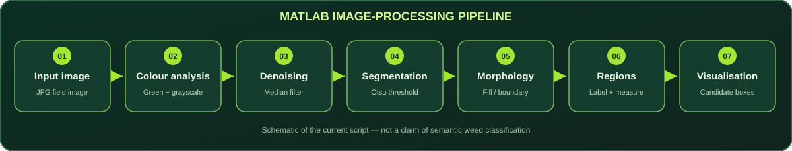
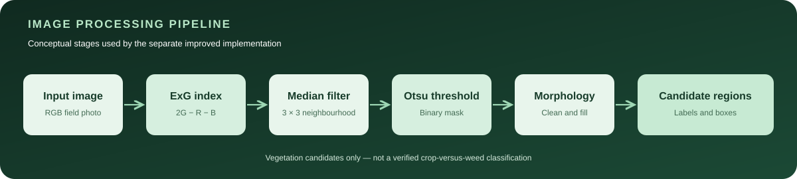
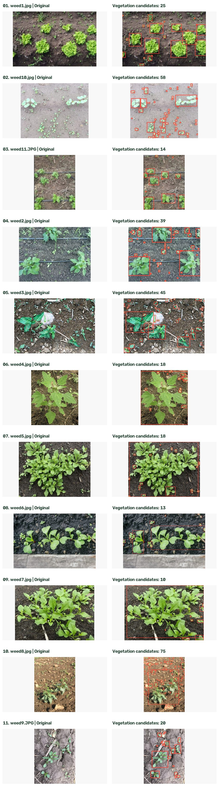

<div align="center">


# 🌱 Weed Detection in Crops

### MATLAB Image Processing Prototype

<p>
  
  
  
</p>

<p>
  <a href="#overview">Overview</a> ·
  <a href="#features">Features</a> ·
  <a href="#getting-started">Getting Started</a> ·
  <a href="#processing-workflow">Workflow</a> ·
  <a href="#sample-results">Sample Results</a> ·
  <a href="#limitations">Limitations</a>
</p>

</div>

---

## Overview

This project explores classical computer-vision techniques for highlighting potential vegetation regions in crop-field images. The MATLAB implementation uses colour information, image filtering, threshold segmentation, morphological operations and connected-component analysis.

The repository preserves the original MATLAB script and includes a separate improved implementation. The sample results below are supplementary Python-generated previews, not MATLAB execution outputs.

> [!IMPORTANT]
> Highlighted regions are vegetation candidates, not confirmed weeds. The current colour-based approach does not reliably distinguish weeds from crop plants and has not been validated as a production weed-recognition system.

## Features

| Capability | Description |
|---|---|
| Image input | Select a field image for processing |
| Vegetation emphasis | Green-channel minus grayscale in the original script; Excess Green (ExG) in the separate improved script |
| Noise reduction | Median filtering |
| Thresholding | Otsu threshold selection |
| Morphology | Hole filling and morphological cleanup |
| Region analysis | Connected-component labelling and region measurements |
| Visualisation | Display candidate regions with bounding boxes |
| Sample previews | Gallery and per-image overlays for 11 supplied sample images |

## Technology

- **Language:** MATLAB
- **Required toolbox:** MATLAB Image Processing Toolbox
- **Methods:** Colour-based vegetation emphasis, filtering, threshold segmentation, mathematical morphology and connected-component analysis
- **Preview provenance:** Separate Python-generated illustrative previews

## Repository Structure

```text
weed-detection/
├── assets/
│   ├── weed-detection-banner.svg
│   ├── processing-workflow.svg
│   └── exg-processing-pipeline.svg
├── results/
│   ├── gallery.jpg
│   ├── processing_summary.csv
│   ├── PROCESSING_NOTES.md
│   └── preview_images/
│       └── *_candidates.jpg
├── README.md
└── weed detection in crops/
    └── Code/
        ├── main.m
        ├── main_improved.m
        └── sample images/
            └── weed1 ... weed11
```

**Code preservation:** The original `weed detection in crops/Code/main.m` is retained unchanged. The improved ExG-based implementation is kept separately in `main_improved.m`.

## Getting Started

### Prerequisites

- MATLAB
- MATLAB Image Processing Toolbox
- A desktop MATLAB session for image selection and figure display

### 1. Clone the repository

```bash
git clone https://github.com/JILLELLARAGHUNATH/weed-detection.git
cd weed-detection
```

### 2. Open the MATLAB code folder

Set the current folder in MATLAB to:

```text
weed detection in crops/Code/
```

### 3. Run the improved implementation

Open `main_improved.m` and select **Run**, or enter:

```matlab
run('main_improved.m')
```

Choose an image when the file-selection dialog opens. The script displays the processing stages and saves intermediate outputs and candidate-region information beside the selected image.

The original `main.m` remains available as the original project implementation.

## Processing Workflow

The original pipeline and the separate improved ExG pipeline are illustrated below.

<p align="center">
  
</p>

The improved implementation follows these stages:

1. Read the input image and prepare its colour channels.
2. Calculate the Excess Green index: `ExG = 2G - R - B`.
3. Normalize the ExG image.
4. Apply a median filter.
5. Select a threshold using Otsu's method.
6. Clean the binary mask using morphological operations and hole filling.
7. Identify connected components and measure candidate regions.
8. Display candidate bounding boxes and export processing outputs.

<p align="center">
  
</p>

The original script uses green-channel minus grayscale. The ExG formula belongs to the separate improved script; these approaches are not identical.

## Sample Results

The following gallery summarises preview outputs generated from the 11 supplied sample images.



### Preview results by sample image

Counts represent connected vegetation-candidate regions remaining after the configured area filter. They are not verified weed counts or accuracy measurements.

| Sample image | Resolution | Candidate regions | Preview |
|---|---:|---:|---|
| weed1.jpg | 606 × 397 | 25 | [View](results/preview_images/weed1_candidates.jpg) |
| weed2.jpg | 374 × 284 | 39 | [View](results/preview_images/weed2_candidates.jpg) |
| weed3.jpg | 600 × 406 | 45 | [View](results/preview_images/weed3_candidates.jpg) |
| weed4.jpg | 350 × 406 | 18 | [View](results/preview_images/weed4_candidates.jpg) |
| weed5.jpg | 644 × 491 | 18 | [View](results/preview_images/weed5_candidates.jpg) |
| weed6.jpg | 1200 × 800 | 13 | [View](results/preview_images/weed6_candidates.jpg) |
| weed7.jpg | 721 × 497 | 10 | [View](results/preview_images/weed7_candidates.jpg) |
| weed8.jpg | 375 × 500 | 75 | [View](results/preview_images/weed8_candidates.jpg) |
| weed9.JPG | 240 × 320 | 20 | [View](results/preview_images/weed9_candidates.jpg) |
| weed10.jpg | 400 × 322 | 58 | [View](results/preview_images/weed10_candidates.jpg) |
| weed11.JPG | 293 × 389 | 14 | [View](results/preview_images/weed11_candidates.jpg) |

- [Open the processing summary CSV](results/processing_summary.csv)
- [Browse all individual preview images](results/preview_images/)
- [Read the preview methodology and limitations](results/PROCESSING_NOTES.md)

> [!NOTE]
> These previews were generated with Python. They are not MATLAB execution outputs or a verified MATLAB-equivalent run. Green regions may include crop plants as well as weeds. Thresholds are calculated independently per image, so candidate counts should not be treated as comparative performance scores.

## Limitations

1. **Crop/weed similarity:** Crop leaves and weeds can have similar colour values, causing false positives or missed regions.
2. **Lighting variation:** Shadows, reflections, exposure and soil conditions affect segmentation.
3. **No semantic classification:** The current pipeline does not identify weed species or reliably distinguish every crop plant from a weed.
4. **No validated ground truth:** Reliable performance metrics require independently annotated reference masks.
5. **Runtime verification:** The MATLAB scripts should be run in MATLAB with the Image Processing Toolbox before making claims about execution or measured performance.

The original script's comparison mask is derived from the input image rather than an independent annotation. Its printed sensitivity, specificity, PPV and NPV should therefore not be presented as validated model-performance metrics.

## Future Enhancements

- Add manually annotated ground-truth masks.
- Build a repeatable train/validation/test dataset.
- Calculate precision, recall, F1-score and IoU using valid annotations.
- Improve robustness to lighting and soil variation.
- Compare classical image processing with deep-learning segmentation methods.

## Author

<div align="center">

**Jillella Raghunath**

<a href="https://github.com/JILLELLARAGHUNATH">
  
</a>

</div>

## License

No license file is currently present. Until a license is added, the repository remains subject to default copyright rules; reuse and redistribution are not automatically permitted.

---

<div align="center">

**Built with MATLAB · Image Processing · Computer Vision 🌱**

</div>
